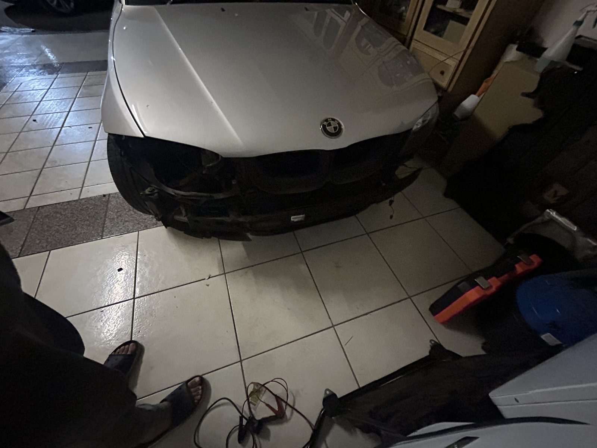
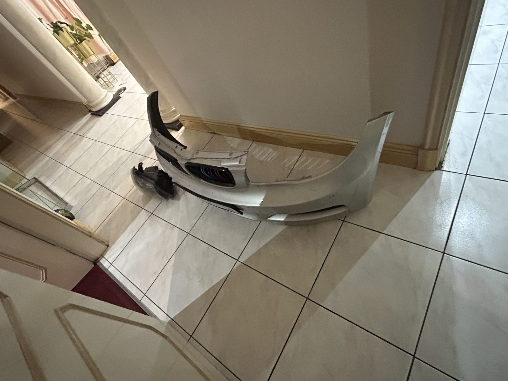
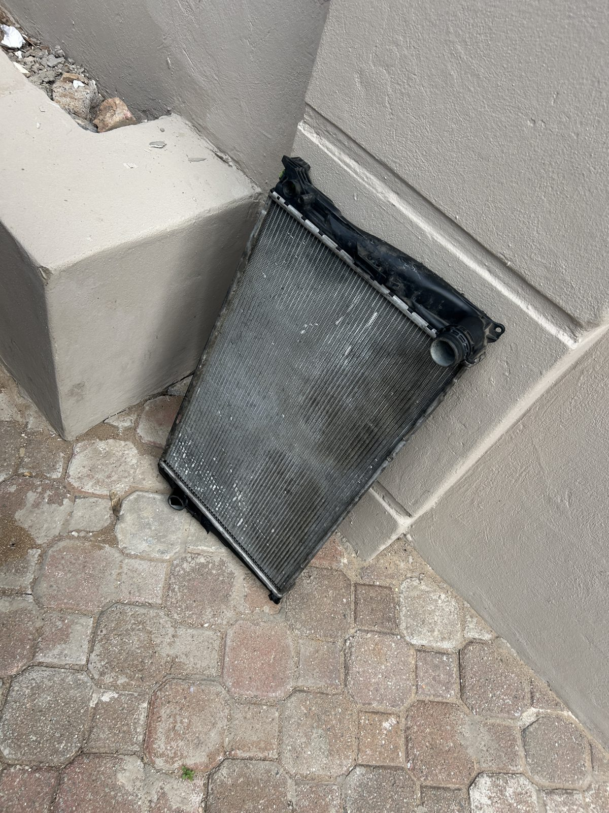
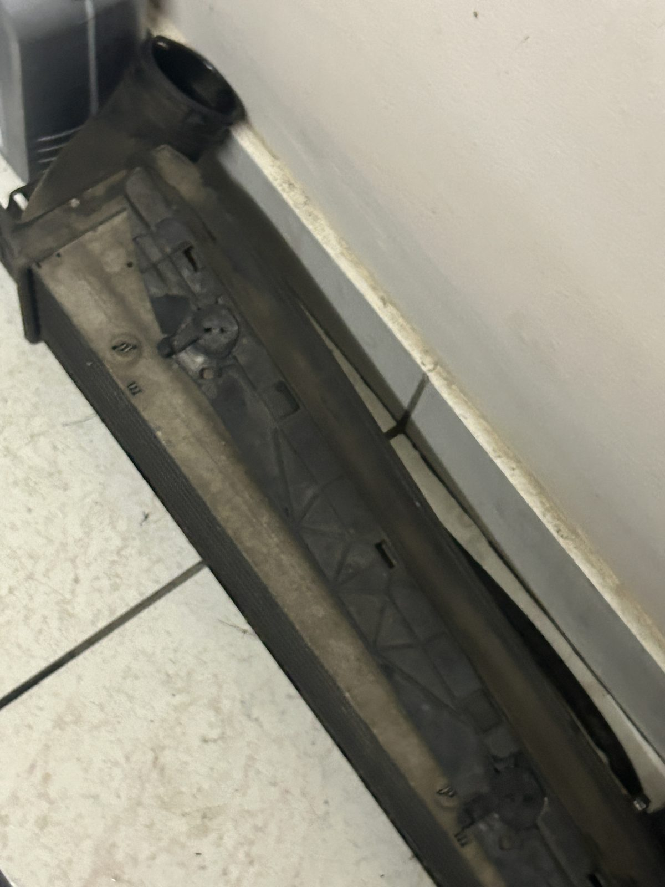
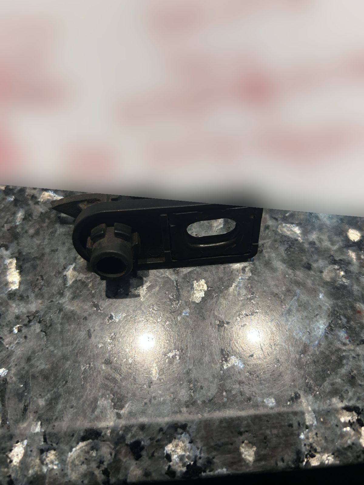
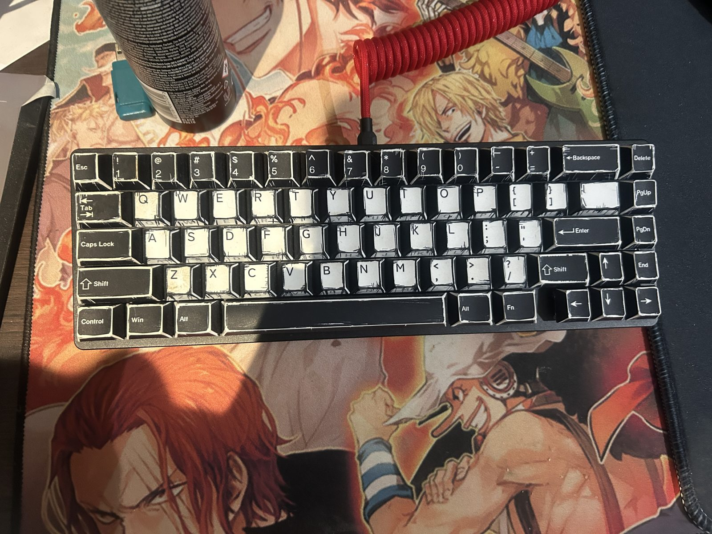
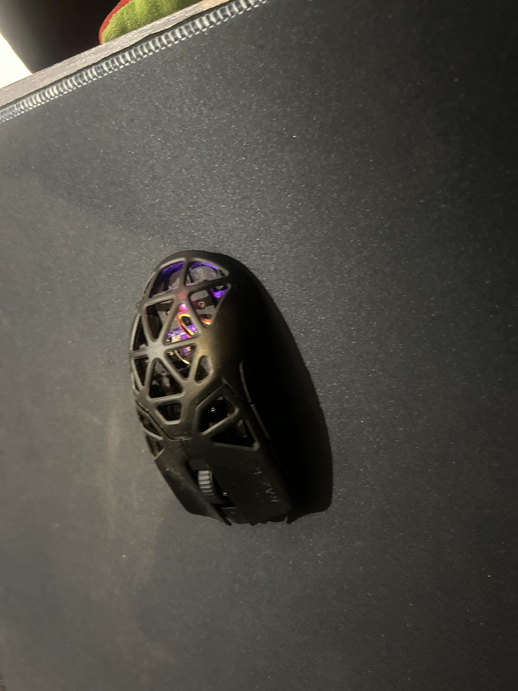

# My Other Passions

Code isn't the only thing I get obsessive about. These are the other things I spend my time on, and they've shaped how I work more than I expected: take it apart, find out why it's failing, fix it properly.

## Cars

I'm into European performance cars, and I've been under the bonnet of a few.

- **Mercedes-Benz W211 E550 (M273 V8):** diagnosed and fixed an Airmatic suspension problem, and worked through a transmission fluid service, vacuum hose repairs, and oil consumption and coolant concerns.
- **BMW 135i (E82, N54 twin-turbo):** I read fault codes with an OBD adapter and BimmerLink, tracked down O2 sensor, boost pressure and DME faults, and found and fixed a boost leak myself. I used realoem.com to decode the VIN and research parts. A tune is planned, and I'm researching the options carefully before spending anything.

### 135i future parts list

The goal: build a monster that destroys my dad's M2 Competition.

- **MHD Stage 2+ tune:** flashed with MHD, with the rev limit raised to 7,600 rpm
- **MOTIV Re|Flex:** flex-fuel support for the tune
- **Upgraded Stage 2 turbos:** to replace the stock twins
- **Higher compression**
- **Water/methanol injection kit:** pump and tank in the boot, line run forward to the engine bay, as the safety margin for the higher boost
- **Charge pipe and blow-off valve:** to replace the weak stock plastic parts
- **UniClutch Sport 875Nm dual-core clutch:** to replace the slipping stock clutch (planning to fit it myself)
- **Heat-soak fixes I'm weighing:** StageFP water-to-air intercooler intake manifold, a bigger front-mount intercooler, and an extra oil cooler
- **Driver's bucket seat:** MOMO Start on an OMP E82 bracket

### Garage wishlist

- **[MaxJax M7K portable two-post lift](https://www.maxjax.com/car-lifts/portable-car-lifts/m7k-standard-package-portable-car-lift-7000-lbs-capacity-5175548-maxjax):** a "half-size" lift that fits my low garage, mainly for dropping the transmission

### Where I source parts

- [NV Performance](https://nvperformance.co.za) (South Africa)
- [Race-Era](https://race-era.co.za) (South Africa)
- [RPM Uni](https://rpmuni.co.za) (South Africa)
- [StageFP](https://stagefp.com) (US)
- Scott's Shipping: importer for US- and EU-spec parts

### Not even a month in

Not even a month into ownership and it's already apart: bumper and headlight off, radiator and intercooler out, and a broken bracket to replace.

  
  

  
  
  

**What it taught me:** diagnose before you replace anything. Fault codes are clues, not answers, and the same approach fixes servers and code. Dream car: a Porsche 930 Turbo.

## Gardening

I grow chillies, tomatoes and citrus. Plants don't care about deadlines, so it's good practice in patience and in watching what's actually happening instead of what I expect.

## Anime and music

I've tracked 600+ anime titles, and I listen to a lot of J-pop, mainly 9lana and Ado.

As of 2026 I've started logging my anime on AniList: [my anime list](https://anilist.co/user/Rikuaganeia/animelist)

## Gaming PC setup

- **PC:** Ryzen 7 5800X (overclocked hard), RTX 3060 Ti, 4TB of storage
- **Case:** Thermaltake Core P5 open-frame ATX, wall-mounted
- **Monitors:** LG ultrawide plus a vertical ASUS ROG, both on monitor arms
- **Mic:** first-gen FIFINE on a boom arm with a pop filter
- **Keyboard:** Glorious GMMK 2 with custom keycaps and Glorious Fox switches
- **Mouse:** Razer Viper Ultimate (v1) in an upgraded 3D-printed shell inspired by the Viper Mini Signature Edition

  
  

## How it connects

Cars, plants, and servers all reward the same habit: stay curious, test one thing at a time, and don't be afraid to break something and learn from it. That's how I want to work in cybersecurity.
